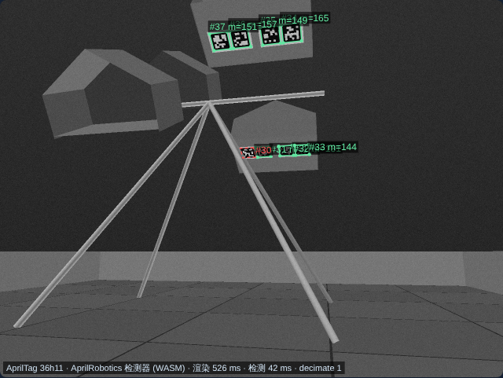
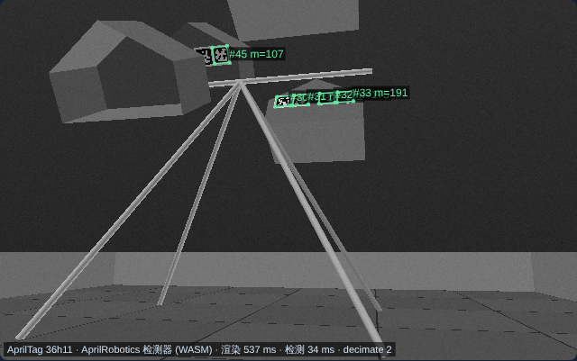
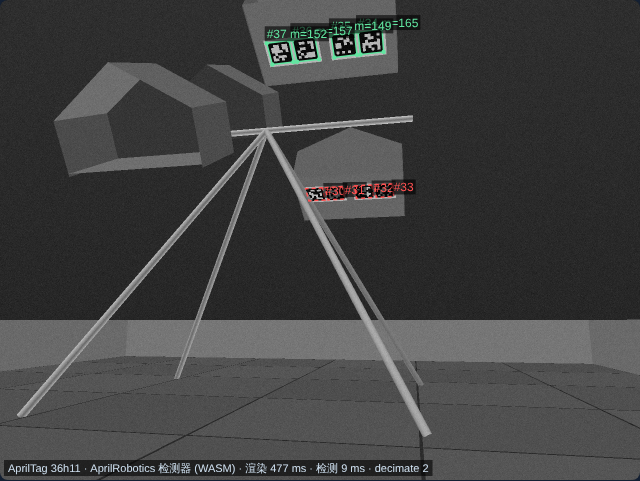
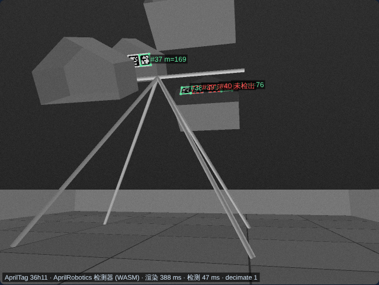
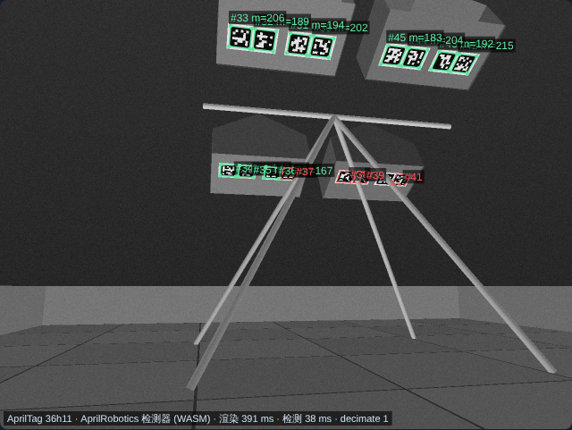
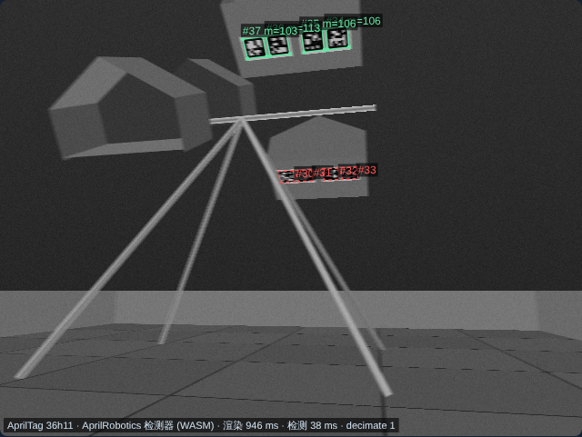

# BIOBUZZ HIVE Shot and Tip Simulator

**English** | [中文](README.zh-CN.md)

Live version: <https://lazer2077.github.io/BIOBUZZ_Simulator/> (GitHub Pages; `.github/workflows/pages.yml` runs the tests and then deploys). To run locally, open `index.html` in a browser; nothing needs to be installed. The button in the top-right corner switches between Chinese and English, and the choice is remembered in the browser. You can also force a language with `?lang=en` or `?lang=zh`; otherwise the browser language is used.

Enter a launch point, speed and angles, and the page shows the 3D trajectory, a side view and the collision result. The target is whichever HIVE, red or blue, is closer in X to the launch point. **Solve angle** searches for a collision-free trajectory into the opening at the current launch speed; only **Launch one ball** adds a scoring ball to the HIVE.

## Keyboard controls

Keys work when no input box has focus (click the 3D view or blank space first). A press applies one fine step; after 200 ms a held key keeps changing the value, and holding Shift makes it faster. While a key is held the trajectory is recomputed at most every 80 ms.

| Key | Action | Press / hold rate (Shift faster) |
|---|---|---|
| W A S D | Move the launch point relative to the 3D view: W away from the camera, S toward it, A/D screen left/right; kept inside the 144 in field | 0.6 m/s (1.5 m/s) |
| ↑ ↓ | Elevation | 0.1° / 8°/s |
| ← → | Yaw (wraps to −180…180°) | 0.2° / 15°/s |
| Q E | Launch speed −/+ | 0.05 m/s / 1 m/s per s |
| R F | Launch height +/− | 1 cm / 0.2 m/s |
| Z X | Orbit the 3D view | — |
| B | Toggle POLLEN / NECTAR | — |
| Enter | Solve angle | — |
| Space | Launch one ball | — |
| C | Reset view | — |
| V | Toggle vision aim | — |
| N | Resample camera noise | — |
| M | Toggle detection mode (image / geometry) | — |

## Model dimensions

- Units are metres and seconds. X runs between the red and blue HIVEs, Y between the two CELLs of one HIVE, and Z is up. The origin is the floor projection of the frame pivot.
- Frame 49.46 in wide, base 38.95 in deep, pivot 43.95 in high; red and blue HIVE centres 25.5 in apart.
- The 18.84 in in Figure 9-9 is the spacing between adjacent CELLs; the CELL thickness beside it is 12.04 in. The displayed CELLs use rib, clear side-panel and back-panel triangle meshes extracted directly from the official STEP file, keeping their real position and shape.
- The CELL opening is about 20 in wide, 14 in high and 12 in deep. The side edges below the apex are 7.61 in. From the official CAD rib bottom edge `(Y=0.5096, Z=1.3237) m` and apex `(Y=0.3054, Z=1.6769) m`, the opening's height direction is about 60° from horizontal; the inner proxy opening uses the clearance between them.
- POLLEN is about 2.8 in in diameter and 0.055 lb; NECTAR is about 3.6 in and 0.091 lb.

Sources: [FIRST official STEP field CAD](https://ftc-resources.firstinspires.org/ftc/field/field-cad-step), [FIRST 2026–27 Competition Manual §9.6, §9.8, §10.3, §10.5](https://ftc-resources.firstinspires.org/ftc/game/manual), [FIRST CELL assembly guide §6](https://ftc-resources.firstinspires.org/ftc/field/initialfieldguide), the [official animation](https://www.youtube.com/watch?v=sUH3z5a5S9I&t=200s) and [AndyMark ball specifications](https://andymark.com/products/biobuzz-scoring-elements). The CAD mesh is extracted by `cad/extract_mesh.py`. The 3D engine is a bundled copy of Three.js; its license is in `vendor/THREE-LICENSE.txt`.

## Physics and scoring logic

Free flight integrates gravity and quadratic drag `F = ρ Cd A |v|² / 2` in 5 ms steps, with air density 1.2 kg/m³ and frontal area `πd²/4`. The `drag` input in the page and the API is the dimensionless `Cd`, default 0.5; 0.3–1.0 is for sensitivity analysis on similar perforated balls and is not a measured range for NECTAR or POLLEN. The closed outer side and back panels use the official CAD triangles for sphere contact, and interior bounces also take the nearest contact point and normal from the CAD triangles. A bounding-volume tree speeds up queries; a pentagon proxy fills the unclosed edges of the CAD mesh and stops balls leaving through anything but the opening. Inside the CELL the ball is simulated in 0.5 ms steps until it bounces out of the opening, comes to rest or reaches a 3 s limit; spring-damper contact with tangential friction approximates ball compression and rebound. The trajectory shows the ball centre and orange dots show contact points. Retention depends on the ball's final position and speed inside the CELL, not on the number of contacts. The three starting NECTAR first settle under gravity, soft wall contact and ball-to-ball contact; a newly retained ball is settled again with them. The tests check the clearance of the starting balls from the CAD ribs, side panels and back panel. The edge proxy still has geometric error; check against a real field before relying on it on a robot.

At the start of an official match each upward CELL holds 3 NECTAR, placed against the back wall in a line along the side nearest that alliance's ALLIANCE AREA (manual §10.3.1: red toward −X, blue toward +X). The simulator shows these starting balls and treats them as the balance baseline; each later ball adds torque based on its AndyMark mass. When the added torque reaches the release threshold set in the page, the HIVE falls to its other stable pose following a simplified equation with moment of inertia, restoring force and damping; the other CELL then faces up and becomes the new target. After a tip, the balls in the original CELL are removed from the count.

**Calibration limits:** the FIRST manual does not give the tip torque, moment of inertia, damping, ball contact stiffness or NECTAR drag coefficient; all of these defaults are placeholders. Balls are modelled as lumped masses with compressible contact; shell deformation is not solved with finite elements and CELL flexibility is not modelled. Ball-to-ball contact is included while settling, but an incoming ball does not yet collide dynamically with balls already in the CELL, so retention predictions for a full CELL are still approximate. Measure real retention rates, tip timing and the number of balls needed on a physical field and adjust the parameters. See [NASA](https://www1.grc.nasa.gov/beginners-guide-to-aeronautics/drag-equation/) for the drag equation; drag on perforated balls is sensitive to hole size and porosity, see the [floorball ball experiments](https://odr.chalmers.se/items/dc68b2a3-48e5-4090-bb6b-023005930f18) and the [wind-tunnel study of perforated hollow spheres](https://www.cambridge.org/core/journals/journal-of-fluid-mechanics/article/drag-on-a-hollow-sphere-can-increase-with-porosity/96AC0BED872B41FDE7C447214028BA77).

## Camera / AprilTag localization

The simulator localizes the robot from a camera that sees the field AprilTags. The pipeline matches what runs on an FTC robot: an image goes through the AprilTag detector, the detector's corners go into a pose solver, and the result is checked before it is used.

```
render camera frame ─► AprilRobotics detector ─► filter decodes ─► undistort corners ─► heading-scan initial pose
 (camera-render.js)     (vendor/apriltag-wasm.js)   (hamming, margin)   (known k1)           (per HIVE-pose hypothesis)
                                                                                                   │
 vision aim ◄─ quality gate (blur, lone far tag) ◄─ multi-frame Kalman fusion ◄─ LM on corner reprojection error, outlier tags removed
```

### Tag layout (Competition Manual TU07 §9.9)

- Sixteen 3.25 in (8.25 cm) tag36h11 tags, in four AprilTag Clusters of four on one sticker each. Each cluster is on the **bottom face of a CELL**: the 20 × 12 in clear panel along the opening's flat lower edge. When the CELL is up, this panel faces down toward the TILES. The sticker's bottom edge points toward the field centre, i.e. toward the CELL's back (Figure 9-16). In the official CAD the panel sits 1.1 cm inside the rim; the tags are on its outer face, and every tag corner lies within 1.2 mm of the CAD panel.
- Within a cluster the tag centres are ±2.75 in and ±6.5 in from the cluster centre along X (Figure 9-15). The reference holes are 9.938 in from the CELL front (the opening edge), and the tag centreline is 2.75 in nearer the front: 7.19 in into the CELL.
- IDs (Figure 9-17): red CELL away from the audience 30–33, red audience CELL 34–37, blue audience CELL 38–41, blue CELL away from the audience 42–45.
- The tags **tip with their HIVE**. The cluster under an upward CELL faces down and out toward that CELL's shooters, so a robot aiming at a HIVE sees that HIVE's two clusters. At the start, from the +Y side, it sees 34–37 under the target CELL and 30–33 under red's lower CELL.
- Since the tag positions depend on how each HIVE is tipped, the solver fits all four HIVE-pose combinations and keeps the one that explains the corners best. It also reports which CELLs are up; a HIVE with no tag in view stays unknown.
- The simulator's +Y is the audience side. In Figure 9-17 the starting NECTAR, which sit in the upward CELLs, are in the red audience CELL and the blue CELL away from the audience; here those are red +Y and blue −Y. The simulator frame is therefore a mirror image of the field in Y. Tag IDs follow the figure's left-to-right order along X, and each tag is drawn readable from in front.

| Red shot, 640×480, decimate 1: 7 tags, error 0.1 cm, aim error 0.002° | Same, 1280×800, decimate 2: 4 tags (the upper cluster leaves the narrower vertical view) | 640×480 with decimate 2: only the nearer cluster 34–37, still 0.1 cm |
|---|---|---|
|  |  |  |
| **Blue shot: 39–45, error 0.1 cm** | **After the red HIVE tips: shooting from −Y, red −Y up detected, aim error 0.01°** | **Turning at 60°/s: the far cluster is lost; 3.8 px of blur, rejected by the gate** |
|  |  |  |

Green: accepted detections (raw corners; m is the decision margin). Orange: discarded decodes. Red dashed: in view geometrically but missed by the detector.

**The tags are small.** From a shooting position 1.5–2 m away a 3.25 in tag spans about 20–30 px in a 640×480, 70° image. With the detector's `quad_decimate` 2 only the nearer cluster decodes. `decimate` 1 (the page default; detection takes about 45 ms in WASM) also gets the farther cluster. At 1280×800 the vertical field of view is narrower, so tilt the camera up to keep both clusters in frame.

- **Detector:** the [AprilRobotics apriltag](https://github.com/AprilRobotics/apriltag) C library, the library under the FTC SDK AprilTagProcessor, compiled to WebAssembly with family tag36h11, `quad_decimate` settable (default 1 here), `refine_edges` on and one thread. The page and the 3D view use the library's own tag36h11 images. `tools/apriltag-wasm/build.sh` rebuilds `vendor/apriltag-wasm.js` (one 184 KB file; license in `vendor/APRILTAG-LICENSE.txt`). Decodes with hamming > 0, decision margin < 10 or an ID outside 30–45 are discarded.
- **Rendered frame (`camera-render.js`):** a software ray caster renders a 640×480, 1280×720 or 1280×800 grayscale image of the tiles and seams, the perimeter walls, the tags (black square plus the white ring), the CELL panels and the HIVE frame legs and crossbar. 640×480 uses 2×2 supersampling. Optional effects: motion blur (sub-frames over the exposure from the forward speed and turn rate), Brown–Conrady radial distortion `k1` (outside the lens image circle stays black), defocus blur, exposure gain and Gaussian sensor noise. A frame renders in about 0.4–0.9 s in the browser, so the page re-renders 180 ms after the last change. "Geometry + corner noise" mode (key M) skips rendering and is instant.
- **Pose solver (`localization.js`):** detector corners are undistorted with the known calibration.
  - **Initial pose:** the tags are tilted, so this works for any tag orientation. With the camera height and pitch known, a heading fixes every corner's viewing ray. The camera position then follows from a linear least-squares fit of those rays through the known corners. The heading is scanned in 2° steps and narrowed by golden-section search, which is exact without noise, even from one tag.
  - **Refinement:** Levenberg–Marquardt minimizes the corner reprojection error over `(x, y, heading, camera pitch)` with Huber weights. The pitch is held to its calibrated value by a ±3° prior; this can be turned off ("Also estimate camera pitch") to solve `(x, y, heading)` with a fixed pitch. With 3 or more tags, a tag whose RMS exceeds 4 px is removed and the solve repeats.
  - **Why pitch is estimated:** the tags hang 0.9–1.3 m up, so range comes largely from elevation, and with a fixed pitch a 1° camera tilt from chassis pitch or mounting moves the pose by about 6 cm, and −3° by about 18 cm. Six shooting positions with vision aim, where "Actual pitch offset" tilts the real camera away from the calibration:

    | Pitch offset | Fixed pitch: shots scoring / worst position error | Pitch estimated: shots scoring / worst position error |
    |---|---|---|
    | 0° | 18/18 / 0.8 cm | 18/18 / 1.0 cm |
    | +2° | 12/18 / 16 cm | 18/18 / 0.8 cm |
    | −3° | 0/18 / 32 cm | 18/18 / 1.1 cm |

    The rendered image with the real detector gives the same picture (−3°: 0/6 against 6/6). Estimating pitch also absorbs most of a camera height error (+3 cm: 6 cm → 1.2 cm). With exact calibration it costs almost nothing (0.6 → 0.7 cm RMS). From a single tag it is slightly worse, but the quality gate rejects a lone distant tag anyway.
  - **Uncertainty:** the 1σ comes from `s²(JᵀJ)⁻¹`. In image mode it also includes a 0.3 px per-corner bias floor that frame averaging does not remove.
  - **Fusion:** several frames (fresh sensor noise each, robot static) are fused with a Kalman filter that also takes odometry.
- **Quality gate:** an estimate is not used in two cases. One is when the expected motion blur `fx·|ω|·T + fx·|v|·T/1.5` exceeds 2 px. The other is when only one tag is seen and it is more than 1.5 m away. The reprojection residual does not reveal either failure.
- **Vision aim:** tick "Aim using the vision pose estimate" (key V). *Solve angle* then uses an estimate only if it passes the gate. The search runs at the estimated position, the robot turns by (field yaw − estimated heading), and the shot is simulated from the true position. The result panel reports the **aim error**: the launch-direction error, the sideways miss it causes at the target, and the range error.

Limits:
- The cluster's position along the CELL is derived from the manual's figures, and checked against the official CAD bottom panel; the depth along the CELL relies on reading "Front of Cell" in Figure 9-15 as the opening edge.
- The simulator's Y axis is mirrored relative to the field (see above).
- Lighting is a single directional light with no shadows, glare or rolling shutter.
- Camera height, intrinsics and distortion are assumed exact; pitch is estimated around its calibration.
- Robots and balls do not occlude the tags.

## Control API

The page exposes a global `window.HiveControl`. Inputs are in metres, metres per second, degrees, newton-metres and seconds. The target is always the HIVE nearest the launch point in X. API calls also update the page controls so you can inspect the result.

```js
const solution = HiveControl.solve({
  x: -0.6, y: 1.8, z: 0.55, speed: 6.5,
  ballType: 'pollen', drag: 0.5
});
if (solution.status === 'hit') {
  console.log(solution.angleDeg, solution.yawDeg, solution.hitPoint);
  const outcome = HiveControl.fire();
  console.log(outcome.tipped, outcome.state.hives);
}
```

Methods:

- `getState()`: the upward CELL, ball counts and tip count for each HIVE, and the current nearest target.
- `predict({...})`: predicts one launch with the given `angleDeg` and `yawDeg`; status is `hit`, `collision` or `miss`, with `internalCollisions` and `retained`. Nothing is added to the ball count.
- `solve({...})`: searches for a collision-free angle for the given launch point, speed and ball type; returns `unreachable` if none exists.
- `fire({...})`: performs one launch with the current parameters; a hit adds the ball, and the HIVE advances to its next stable pose once the threshold is reached. The API computes this instantly; the page button animates it.
- `reset()`: restores the official starting orientation with 3 NECTAR per HIVE.
- `localize({...})`: runs the camera at the given pose (`x`, `y`, `yawDeg` as the heading) and returns the true and estimated pose, the error, 1σ, the detected tag IDs and the rejection reasons. It also accepts `cameraHeight`, `cameraPitchDeg`, `cameraFovDeg`, `frames` and an integer `seed`; `mode: 'image'` (rendered frame and real detector) or `'geometry'`, with `pixelNoise` for geometry and `sensorNoise`, `exposureGain`, `exposureMs`, `driveSpeed`, `turnRateDegS`, `k1`, `defocus`, `decimate` for image mode. `resolution` is `'640x480'`, `'1280x720'` or `'1280x800'`; `pitchErrorDeg` tilts the real camera away from its calibration and `estimatePitch` (default true) solves for pitch. The result also has `pitchDeg`, the estimated pitch. The result adds `mode`, `gate`, `aim` (`yawErrDeg`, `lateralAtTarget`, `rangeError`), `hiveUp` (which CELL of each HIVE the tags say is up, or null if unseen), `timing` and `missedTagIds`. Image mode needs the detector: `await HiveControl.whenDetectorReady()` first.
- `solve({..., useVision: true})`: aims from the vision estimate; the result's `vision` field gives the estimate and its error.
- `getTags()`: the tag layout in use.

Collision `kind` values returned by the API (`封闭背板` closed back panel, `侧面` side panel, `开口边框` opening rim, `内壁 n` inner wall n) are fixed identifiers and do not change with the page language.

Run `node collision.test.js` to check collisions, nearest-HIVE selection, auto-aiming, re-aiming after a tip, the control API, vision aiming, the Chinese and English page text and the keyboard controls. Run `node localization.test.js` to check exact pose recovery without noise, covariance calibration, multi-frame fusion, outlier rejection, the official tag layout (IDs, spacing, order, tipping with the HIVE), HIVE-pose recovery, the heading-scan initial pose, the quality gate, the detector's rejection reasons and the image pipeline: the real detector on rendered frames, corner order, decimate and resolution, distortion and motion blur.

## Check against official sources (2026-27 Competition Manual TU02)

| Item | Official value | Simulator | Result |
|---|---|---|---|
| Frame width / base depth / pivot height | 49.46 / 38.95 / 43.95 in (§9.6.1) | Same | ✓ |
| Red–blue HIVE centre spacing | 25.5 in (Fig. 9-10) | 25.5 in | ✓ |
| Stable poses | Arm ±30° from horizontal, 60° per tip (Fig. 9-10) | 60° | ✓ |
| CELL opening | About 20 × 14 × 12 in (§9.6.2) | Same, plus official STEP mesh | ✓ |
| Opening bottom / top above tiles | 53.5 / 65.6 in (Fig. 9-10) | CAD rib outer edge 52.1 / 66.0 in | Within the "approximately" tolerance |
| POLLEN / NECTAR | 2.8 in, 0.055 lb / 3.6 in, 0.091 lb (§9.8, AndyMark) | Same | ✓ |
| Starting state | Red audience-side CELL up, blue far-side CELL up, 3 NECTAR each (Fig. 10-2) | Same | ✓ |
| Tip / retained-ball points | TIP 20 points; 2 points per ball left in an upward CELL at match end (Table 10-2) | Original CELL emptied after a tip | ✓ |

Fixed issues:

1. **Downward CELL proxy geometry was misplaced by about 19 cm.** In the official CAD each HIVE is mirror-symmetric about the vertical plane through its pivot (both CELLs sit on the same side of the arm), but the original code built the downward CELL by point symmetry about the pivot. As a result, after a tip the opening the solver aimed at, the opening-plane crossing test and the in-CELL coordinate frame were all about 19 cm (about 26° around the pivot) away from the real CAD CELL, and the downward CELL's opening rim caused false collisions in empty space. The downward CELL is now the same side's upward pose rotated 60° about the pivot; all four CELLs match the CAD within 1 cm in both stable poses, and `collision.test.js` has a regression check.
2. **Starting NECTAR placement.** They were centred; they now sit toward the alliance's own side as the manual specifies.

Still assumed and needing measurement (see "Calibration limits" above): the tip threshold (the default 0.30 N·m means about 4 POLLEN on top of the 3 NECTAR), drag coefficient, contact stiffness and damping, and tip dynamics. Also, the simulator picks the HIVE nearest the launch point in X, but in a match each alliance may only launch into the HIVE of its own colour (§10.5.1, G417), so keep the launch point on your alliance's HIVE side.
