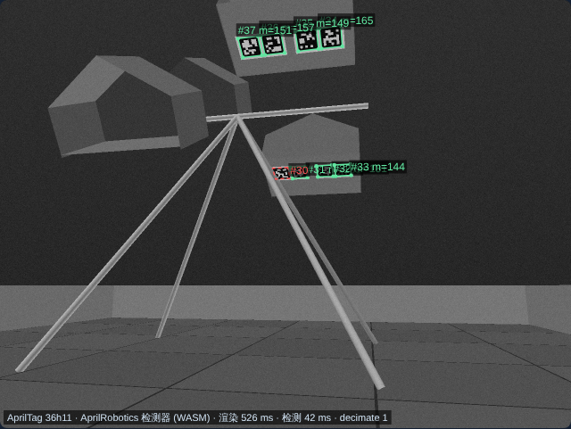
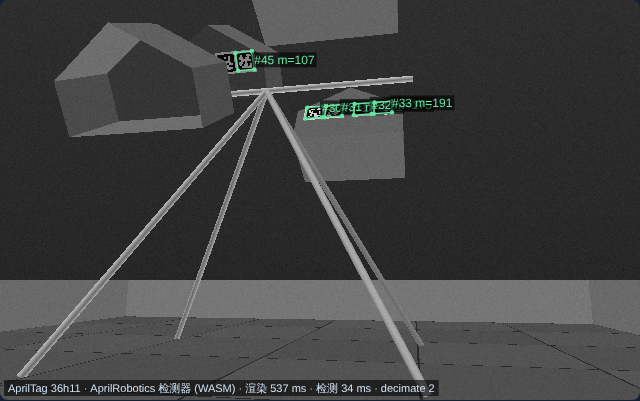
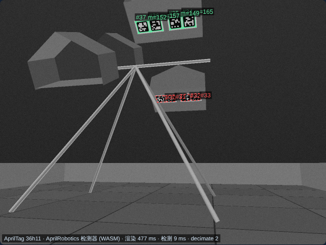
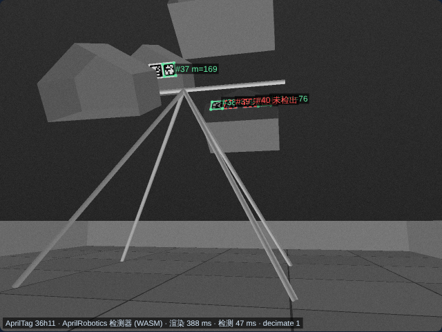
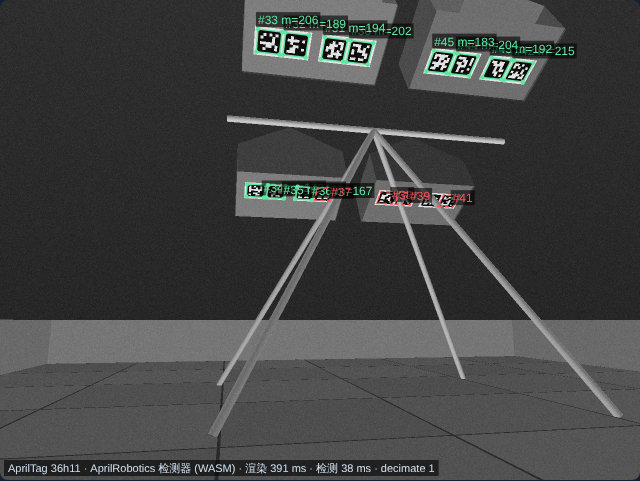
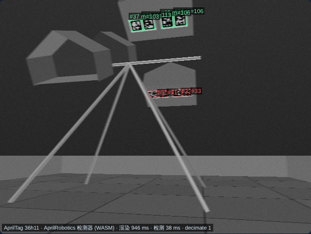

# BIOBUZZ HIVE 射击与翻转模拟器

[English](README.md) | **中文**

在线版本：<https://lazer2077.github.io/BIOBUZZ_Simulator/>（GitHub Pages，由 `.github/workflows/pages.yml` 先跑测试再部署）。本地用浏览器打开 `index.html` 即可，无需安装依赖。页面右上角按钮可在中文和英文之间切换，选择会保存在浏览器中；也可用 `?lang=en` 或 `?lang=zh` 直接指定语言（未指定时按浏览器语言）。输入发射点、初速和角度后，页面显示三维轨迹、侧视图及碰撞判定。目标会根据发射点 X 坐标选择较近的红色或蓝色 HIVE。“自动求解角度”在当前初速下寻找无碰撞的开口轨迹；点击“发射一球”才会把命中的球计入 HIVE。

## 键盘操作

焦点不在输入框时键盘生效（可先点击三维视图或空白处）。按一下调整一个细步长；按住 200 ms 后持续变化，同时按住 Shift 更快。按住期间轨迹最多每 80 ms 重新计算一次。

| 按键 | 作用 | 单按步长 / 按住速率（Shift 更快） |
|---|---|---|
| W A S D | 按三维视角移动发射点：W 远离镜头，S 靠近镜头，A/D 屏幕左右；限制在 144 in 场地内 | 0.6 m/s（1.5 m/s） |
| ↑ ↓ | 仰角 | 0.1° / 8°/s |
| ← → | 水平角（在 −180…180° 内循环） | 0.2° / 15°/s |
| Q E | 初速 −/+ | 0.05 m/s / 每秒 1 m/s |
| R F | 发射高度 +/− | 1 cm / 0.2 m/s |
| Z X | 旋转三维视角 | — |
| B | 切换 POLLEN / NECTAR | — |
| Enter | 自动求解角度 | — |
| 空格 | 发射一球 | — |
| C | 重置视角 | — |
| V | 开关视觉瞄准 | — |
| N | 重新采样相机噪声 | — |
| M | 切换检测方式（图像 / 几何） | — |

## 模型尺寸

- 坐标单位为米、秒。X 沿红蓝 HIVE 排列方向，Y 沿同一 HIVE 的两个 CELL 排列方向，Z 向上。原点是框架转轴的地面投影。
- 框架宽 49.46 in、底座深 38.95 in、转轴高 43.95 in；红蓝 HIVE 中心相距 25.5 in。
- 图 9-9 中的 18.84 in 是相邻 CELL 之间的间距，旁边还标有 CELL 厚度 12.04 in。用于显示的 CELL 由官方 STEP 直接提取肋框、透明侧板和背板三角网格，保留其真实位置与造型。
- CELL 开口宽约 20 in、高约 14 in、深约 12 in。图中尖顶以下的侧边高度为 7.61 in。根据官方 CAD 肋框底边 `(Y=0.5096, Z=1.3237) m` 与尖顶 `(Y=0.3054, Z=1.6769) m`，开口高度方向相对水平面约 60°；内侧代理开口取两者之间的净空。
- POLLEN 直径约 2.8 in、质量 0.055 lb；NECTAR 直径约 3.6 in、质量 0.091 lb。

来源：[FIRST 官方 STEP 场地 CAD](https://ftc-resources.firstinspires.org/ftc/field/field-cad-step)、[FIRST 2026–27 Competition Manual §9.6、§9.8、§10.3、§10.5](https://ftc-resources.firstinspires.org/ftc/game/manual)、[FIRST CELL 装配指南 §6](https://ftc-resources.firstinspires.org/ftc/field/initialfieldguide)、[官方动画](https://www.youtube.com/watch?v=sUH3z5a5S9I&t=200s)和[AndyMark 球规格](https://andymark.com/products/biobuzz-scoring-elements)。CAD 网格的提取脚本是 `cad/extract_mesh.py`。三维引擎使用本地打包的 Three.js，许可证见 `vendor/THREE-LICENSE.txt`。

## 物理和判定

球的自由飞行按 5 ms 步长积分重力与平方阻力 `F = ρ Cd A |v|² / 2`，空气密度取 1.2 kg/m³，迎风面积取 `πd²/4`。界面 `drag` 和 API `drag` 输入的是无量纲 `Cd`，默认 0.5；0.3–1.0 仅供同类穿孔球的灵敏度分析，并非 NECTAR 或 POLLEN 的实测范围。外部封闭侧板和背板使用官方 CAD 三角面进行球体接触检测，内部反弹也从 CAD 三角面求最近接触点与法向量。碰撞树用于加速查询；五边形代理补足 CAD 网格未封闭的边缘，并限制球从非开口侧穿出。球在腔内以 0.5 ms 步长计算，直至弹出开口、静止或到达 3 秒上限；弹簧阻尼与切向摩擦近似球的压缩和回弹。轨迹画球心，橙点画接触点。留球由腔体内位置与最终速度决定，与碰撞次数无关。初始三颗 NECTAR 用重力、壁面软接触及球间接触先行沉降；新球留在腔体后也重新沉降。测试检查初始球与 CAD 肋框、侧板、背板的净空。边缘代理仍有几何误差，上机前应按实物校验。

官方比赛初始状态下，每个向上 CELL 有 3 颗 NECTAR，按手册 §10.3.1 贴住背板、沿靠近本联盟区一侧排成一行（红色靠 −X，蓝色靠 +X）。模拟器据此显示初始球数，并将它们视作平衡调校的基线；后续进入的球按 AndyMark 质量增加附加力矩。附加力矩达到界面中的释放阈值后，HIVE 以转动惯量、恢复力和阻尼的简化方程下坠到另一稳定姿态；随后新 CELL 朝上并重新瞄准。翻转后模型将原 CELL 中的球移出计数。

**标定限制：** FIRST 手册没有给出翻转力矩、转动惯量、阻尼、球体接触刚度或 NECTAR 阻力系数；这些默认参数都是演示值。球体用集中质量和可压缩接触近似，尚未使用有限元计算球壳变形，也未模拟篮筐柔性。沉降中的球间接触已计算，但飞入的新球尚未与已存球共同进行动态碰撞求解，因此满载 CELL 的留球预测仍有误差。实际留球率、翻转时间与所需球数应在实物场地上测量后调整。阻力方程见 [NASA](https://www1.grc.nasa.gov/beginners-guide-to-aeronautics/drag-equation/)；穿孔球阻力对孔径与孔隙率敏感，见 [floorball 球实验研究](https://odr.chalmers.se/items/dc68b2a3-48e5-4090-bb6b-023005930f18)和[穿孔空心球风洞研究](https://www.cambridge.org/core/journals/journal-of-fluid-mechanics/article/drag-on-a-hollow-sphere-can-increase-with-porosity/96AC0BED872B41FDE7C447214028BA77)。

## 相机 / AprilTag 定位

模拟器用相机识别场地 AprilTag 来定位机器人，流程与 FTC 机器人上一致：图像经过 AprilTag 检测器，检测到的角点交给位姿求解，结果先检查再使用。

```
渲染相机图像 ─► AprilRobotics 检测器 ─► 过滤解码 ─► 用标定去畸变 ─► 扫描朝向求初值
(camera-render.js)  (vendor/apriltag-wasm.js)  (纠错位、余量)   (已知 k1)       (逐个 HIVE 朝向假设)
                                                                                    │
 视觉瞄准 ◄─ 质量门限（模糊、单个远标签）◄─ 多帧卡尔曼融合 ◄─ 角点重投影误差 LM 优化，剔除离群标签
```

### 标签布置（竞赛手册 TU07 §9.9）

- 16 个 3.25 in（8.25 cm）tag36h11 标签，分成 4 组 AprilTag Cluster，每组 4 个印在一张贴纸上。每组贴在 **CELL 底面**：开口平直下边那一侧 20 × 12 in 的透明面板。CELL 朝上时这块面板朝下、对着地垫。贴纸下边朝向场地中心，也就是朝向 CELL 背板（图 9-16）。官方 CAD 中这块面板比边框缩进 1.1 cm；标签贴在面板外侧，每个标签角点距 CAD 面板都在 1.2 mm 以内。
- 组内标签中心沿 X 距组中心 ±2.75 in 和 ±6.5 in（图 9-15）。定位孔距 CELL 前缘（开口边）9.938 in，标签中心线比定位孔更靠近前缘 2.75 in，即距开口 7.19 in。
- ID（图 9-17）：红色远离观众侧 CELL 30–33，红色观众侧 CELL 34–37，蓝色观众侧 CELL 38–41，蓝色远离观众侧 CELL 42–45。
- 标签 **随 HIVE 翻转**。朝上 CELL 下方的标签组朝下、朝外，正对往这个 CELL 射击的机器人，所以瞄准某个 HIVE 时看到的是这个 HIVE 的两组标签。开局从 +Y 侧看到目标 CELL 下的 34–37 和红色下方 CELL 的 30–33。
- 标签位置取决于 HIVE 的翻转状态，因此求解器对 4 种 HIVE 朝向组合分别拟合，取最能解释角点的一种，并给出哪个 CELL 朝上；没看到任何标签的 HIVE 记为未知。
- 模拟器的 +Y 是观众侧。图 9-17 中开局的 NECTAR（在朝上的 CELL 里）位于红色观众侧 CELL 和蓝色远离观众侧 CELL，在本模拟器中即红 +Y、蓝 −Y。因此模拟器坐标在 Y 方向是场地的镜像。标签 ID 按图中沿 X 从左到右的顺序排列，每个标签从正面看都是正向图案。

| 红方射击，640×480、decimate 1：7 个标签，误差 0.1 cm，瞄准误差 0.002° | 同位置 1280×800、decimate 2：4 个标签（垂直视场较窄，上方一组出画） | 640×480 用 decimate 2：只检出较近的 34–37，误差仍为 0.1 cm |
|---|---|---|
|  |  |  |
| **蓝方射击：39–45 号，误差 0.1 cm** | **红 HIVE 翻转后：从 −Y 侧射击，判断出红 −Y 朝上，瞄准误差 0.01°** | **以 60°/s 转向：丢失较远一组；模糊 3.8 px，被门限拒绝** |
|  |  |  |

绿色：采用的检测（原始角点，m 为解码余量）；橙色：丢弃的解码；红色虚线：几何上可见但检测器没检出。

**标签很小。** 在 1.5–2 m 外的射击位置，3.25 in 标签在 640×480、70° 画面中约 20–30 px。检测器 `quad_decimate` 为 2 时只能解出较近的一组；`decimate` 1（页面默认；WASM 中检测约 45 ms）也能解出较远的一组。1280×800 的垂直视场较窄，相机要上仰一些才能把两组都拍进画面。

- **检测器：** [AprilRobotics apriltag](https://github.com/AprilRobotics/apriltag) C 库，也就是 FTC SDK AprilTagProcessor 底层的库，编译为 WebAssembly；标签族 tag36h11，`quad_decimate` 可调（本页默认 1），开启 `refine_edges`，单线程。页面和三维视图里的标签图案也直接来自该库。`tools/apriltag-wasm/build.sh` 可重新生成 `vendor/apriltag-wasm.js`（单文件 184 KB，许可证见 `vendor/APRILTAG-LICENSE.txt`）。纠错位 > 0、解码余量 < 10 或 ID 不在 30–45 的解码会被丢弃。
- **渲染图像（`camera-render.js`）：** 软件光线投射渲染 640×480、1280×720 或 1280×800 灰度图，包含地垫和接缝、围墙、标签（黑框加白边）、CELL 面板、HIVE 支架腿和横梁；640×480 用 2×2 超采样。可选效果：运动模糊（按前进速度和角速度在曝光时间内取多个子帧）、Brown–Conrady 径向畸变 `k1`（镜头成像圆外为黑）、失焦模糊、曝光增益和高斯传感器噪声。浏览器里渲染一帧约 0.4–0.9 s，所以页面在最后一次修改后 180 ms 才重新渲染；“几何 + 角点噪声”模式（M 键）不渲染，立即出结果。
- **位姿求解（`localization.js`）：** 检测器角点先按已知标定去畸变。
  - **初值：** 标签是倾斜的，所以初值方法适用于任意朝向的标签。相机高度和俯仰已知时，给定朝向就确定了每个角点的视线，相机位置再由这些视线穿过已知角点的线性最小二乘求出。朝向按 2° 扫描后用黄金分割收窄，无噪声时精确，只有一个标签也行。
  - **优化：** 在 `(x, y, 朝向, 相机俯仰)` 上用 Levenberg–Marquardt 最小化角点重投影误差，带 Huber 权重。俯仰带 ±3° 先验，约束在标定值附近；可以关闭（“同时估计相机俯仰”），改为固定俯仰只求 `(x, y, 朝向)`。看到 3 个及以上标签时，RMS 超过 4 px 的标签被剔除后重解。
  - **为什么要估计俯仰：** 标签挂在 0.9–1.3 m 高处，距离主要靠仰角推算。固定俯仰时，车体前后晃动或安装误差造成 1° 的相机倾斜就会让位姿偏约 6 cm，−3° 偏约 18 cm。下表是 6 个射击位置的视觉瞄准结果，“实际俯仰偏差”表示真实相机相对标定值的倾斜：

    | 俯仰偏差 | 固定俯仰：进球数 / 最大位置误差 | 估计俯仰：进球数 / 最大位置误差 |
    |---|---|---|
    | 0° | 18/18 / 0.8 cm | 18/18 / 1.0 cm |
    | +2° | 12/18 / 16 cm | 18/18 / 0.8 cm |
    | −3° | 0/18 / 32 cm | 18/18 / 1.1 cm |

    图像模式（真实检测器）结果一致（−3°：0/6 对 6/6）。估计俯仰也能吸收大部分相机高度误差（+3 cm：6 cm → 1.2 cm）。标定准确时几乎没有代价（RMS 0.6 → 0.7 cm）。只有一个标签时略差，但单个远处标签本来就会被质量门限拒绝。
  - **不确定度：** 1σ 来自 `s²(JᵀJ)⁻¹`；图像模式还计入每个角点 0.3 px 的系统偏差下限，多帧平均无法消除这部分。
  - **融合：** 多帧（机器人静止，每帧重新加传感器噪声）用卡尔曼滤波融合，也可输入里程计。
- **质量门限：** 两种情况下不使用该估计：预计运动模糊 `fx·|ω|·T + fx·|v|·T/1.5` 超过 2 px；只看到 1 个标签且距离超过 1.5 m。这两种失效从重投影残差上看不出来。
- **视觉瞄准：** 勾选“用视觉估计的位姿瞄准”（V 键）后，*自动求解角度* 只使用通过门限的估计。在估计位置上搜索，机器人按（场地水平角 − 估计朝向）转动，射击从真实位置模拟。结果栏给出 **瞄准误差**：发射方向误差、它在目标处造成的横向偏差，以及距离误差。

局限：
- 标签组沿 CELL 的位置是按手册图纸推算的，并已与官方 CAD 底面面板核对；沿 CELL 深度方向的位置依赖于把图 9-15 的“Front of Cell”理解为开口边。
- 模拟器的 Y 轴与场地是镜像关系（见上文）。
- 光照只有一个方向光，没有阴影、反光和卷帘快门。
- 相机高度、内参和畸变假定精确；俯仰在标定值附近估计。
- 机器人和球不会遮挡标签。

从一帧渲染图像到位姿、瞄准和标注图片的完整示例见 [`examples/`](examples/README.zh-CN.md)（`node examples/solve-example.js`）。

## 控制算法接口

页面提供全局 `window.HiveControl`，输入为米、米每秒、角度、牛顿米和秒。目标 HIVE 永远按发射点 X 坐标选最近的一组。接口调用会同步更新页面控件，便于检查算法结果。

```js
const solution = HiveControl.solve({
  x: -0.6, y: 1.8, z: 0.55, speed: 6.5,
  ballType: 'pollen', drag: 0.5
});
if (solution.status === 'hit') {
  console.log(solution.angleDeg, solution.yawDeg, solution.hitPoint);
  const outcome = HiveControl.fire();
  console.log(outcome.tipped, outcome.state.hives);
}
```

接口方法：

- `getState()`：返回红蓝 HIVE 的向上 CELL、球数、翻转次数和当前最近目标。
- `predict({...})`：使用给定 `angleDeg`、`yawDeg` 预测一次发射；状态为 `hit`、`collision` 或 `miss`，并返回 `internalCollisions` 与 `retained`，不计入球数。
- `solve({...})`：在给定发射点、初速和球种下寻找无碰撞的角度；无解时返回 `unreachable`。
- `fire({...})`：执行当前参数的一次发射；命中后增加球数，并在达到阈值时推进 HIVE 到下一稳定状态。此 API 即时完成计算，界面按钮则播放动画。
- `reset()`：恢复官方比赛初始方向和每组 3 颗 NECTAR。
- `localize({...})`：在给定位姿（`x`、`y`，`yawDeg` 作为朝向）运行相机，返回真实与估计位姿、误差、1σ、检测到的标签 ID 和拒绝原因。也接受 `cameraHeight`、`cameraPitchDeg`、`cameraFovDeg`、`frames` 和整数 `seed`；`mode: 'image'`（渲染图像 + 真实检测器）或 `'geometry'`，几何模式用 `pixelNoise`，图像模式用 `sensorNoise`、`exposureGain`、`exposureMs`、`driveSpeed`、`turnRateDegS`、`k1`、`defocus`、`decimate`。`resolution` 可取 `'640x480'`、`'1280x720'` 或 `'1280x800'`；`pitchErrorDeg` 让真实相机偏离标定俯仰，`estimatePitch`（默认 true）同时求解俯仰。返回值另含估计的俯仰 `pitchDeg`。返回值另含 `mode`、`gate`、`aim`（`yawErrDeg`、`lateralAtTarget`、`rangeError`）、`hiveUp`（标签显示的各 HIVE 朝上 CELL，没看到为 null）、`timing` 和 `missedTagIds`。图像模式需要先 `await HiveControl.whenDetectorReady()`。
- `solve({..., useVision: true})`：用视觉估计瞄准，结果的 `vision` 字段给出估计值与误差。
- `getTags()`：当前使用的标签布置。

接口返回的碰撞类型 `kind`（如 `封闭背板`、`侧面`、`开口边框`、`内壁 n`）是固定标识，不随界面语言变化。

运行 `node collision.test.js` 可验证碰撞、最近 HIVE 选择、自动命中、翻转后的再次瞄准、控制接口、视觉瞄准、中英文界面文字以及键盘操作。运行 `node localization.test.js` 可验证无噪声时精确恢复位姿、协方差校准、多帧融合、离群点剔除、官方标签布置（ID、间距、顺序、随 HIVE 翻转）、HIVE 朝向识别、扫描朝向的初值、质量门限、检测器的拒绝原因，以及图像流程：真实检测器处理渲染图像、角点顺序、decimate 与分辨率、畸变和运动模糊。

## 与官方资料核对（2026-27 Competition Manual TU02）

| 项目 | 官方值 | 模拟器 | 结论 |
|---|---|---|---|
| 框架宽 / 底深 / 转轴高 | 49.46 / 38.95 / 43.95 in（§9.6.1） | 相同 | ✓ |
| 红蓝 HIVE 中心距 | 25.5 in（图 9-10） | 25.5 in | ✓ |
| 稳定姿态 | 臂与水平 ±30°，翻转 60°（图 9-10） | 60° | ✓ |
| CELL 开口 | 约 20 × 14 × 12 in（§9.6.2） | 同值 + 官方 STEP 网格 | ✓ |
| 开口底 / 顶离地 | 53.5 / 65.6 in（图 9-10） | CAD 肋框外缘 52.1 / 66.0 in | 在“约”值误差内 |
| POLLEN / NECTAR | 2.8 in、0.055 lb / 3.6 in、0.091 lb（§9.8、AndyMark） | 相同 | ✓ |
| 初始状态 | 红色观众侧 CELL 朝上、蓝色远端 CELL 朝上，各 3 NECTAR（图 10-2） | 相同 | ✓ |
| 翻转得分 / 留球得分 | TIP 20 分；比赛结束时朝上 CELL 内每球 2 分（表 10-2） | 翻转后原 CELL 球清空 | ✓ |

已修正的问题：

1. **朝下 CELL 的代理几何位置错误（约 19 cm）。** 官方 CAD 中 HIVE 关于转轴竖直面镜像对称（两个 CELL 都位于连杆同一侧），原代码却按绕转轴点对称生成朝下 CELL。结果：翻转后求解器瞄准的开口、开口平面穿越判定和腔内坐标系都偏离实际 CAD CELL 约 19 cm（绕转轴约 26°），朝下 CELL 的开口边框也会在空处产生虚假碰撞。现在朝下 CELL 由同侧朝上姿态绕转轴旋转 60° 得到，四个 CELL 在两种稳定姿态下与 CAD 的偏差都在 1 cm 内；`collision.test.js` 新增回归断言。
2. **初始 NECTAR 摆放。** 原先居中摆放，现按手册靠本联盟一侧排列。

仍属假设、需要实测标定的部分见上文“标定限制”：翻转阈值（默认 0.30 N·m 对应 3 颗 NECTAR 之外约 4 颗 POLLEN）、阻力系数、接触刚度与阻尼、翻转动力学。另外，模拟器按发射点 X 自动选择最近的 HIVE；比赛中各联盟只能向本色 HIVE 发射（§10.5.1、G417），使用时请让发射点位于本联盟 HIVE 一侧。
