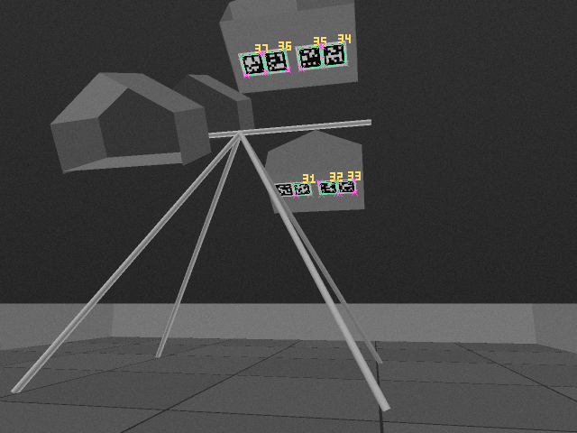
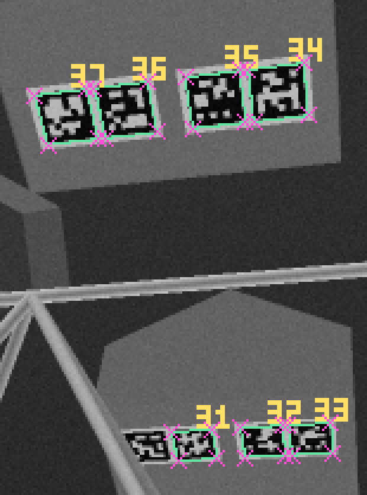

# Example: one camera frame to a pose and an aim

**English** | [中文](README.zh-CN.md)

```bash
node examples/solve-example.js
```

The script runs the whole pipeline once, outside the page:

1. **Scenario:** the red shooter at (−0.6, 1.8) m, heading −78.7°, faces its upward CELL. The 640×480, 70° camera is 0.30 m up. It was calibrated at 10° pitch, but the chassis is tilted 2° nose-up, so the real camera looks up at 12°. Sensor noise is σ = 3 gray levels.
2. **Render** the frame the camera sees: tiles, walls, the official CELL tags (Manual §9.9), the CELL panels and the HIVE frame.
3. **Detect** with the AprilRobotics detector compiled to WebAssembly (`decimate` 1), keeping only exact decodes with a decision margin of at least 10.
4. **Solve** for `(x, y, heading, pitch)`, with the pitch held to its 10° calibration by a ±3° prior. The solve is tried against all four HIVE-pose layouts, and three frames are fused.
5. **Check** the result with the quality gate, and compute what it means for the shot: the turn to the opening centre and the launch-direction error.

Outputs in [`output/`](output):

- [`camera.png`](output/camera.png): the frame as the detector saw it. Green: detected corners, with the tag ID in yellow. Magenta crosses: the tag corners reprojected from the estimated pose and pitch.
- [`camera-zoom.png`](output/camera-zoom.png): the same, 4× around the tags.
- [`result.json`](output/result.json): every detection with its corners, the estimate with 1σ, the error against the truth, the aim and the gate.
- [`console.txt`](output/console.txt): the printed report.





```
Robot (true)      x=-0.6 m  y=1.8 m  heading=-78.7°
Camera            640x480, HFOV 70°, height 0.3 m, pitch calibrated 10° / actual 12°
Detected tags     31(m=137.1) 32(m=133.3) 33(m=147.1) 34(m=164.8) 35(m=151.5) 36(m=157.6) 37(m=150.6)
Upward CELLs      red +Y, blue not seen (from the best-fitting layout)
Estimate          x=-0.5998 m  y=1.7998 m  heading=-78.708°  pitch=12.021°
1σ                x 0.18 cm, y 0.17 cm, heading 0.073°;  reprojection RMS 0.065 px, 3 frames
Error             position 0.03 cm, heading -0.008°
Aim               turn -0.08°, launch direction error 0.002° (0.01 cm sideways), range error -0.03 cm
Quality gate      passed (motion blur 0.0 px)
Fixed-pitch solve position error 12 cm, heading -0.44° (pitch held at the calibration)
```

How to read it:

- **What is in view:** seven tags decode, 34–37 under the target CELL and 31–33 under red's lower CELL. Tag 30 does not decode because a frame leg (1 in tube) passes in front of two of its corners: the sight lines to them pass 0.1 cm and 1.6 cm from the leg's axis, against a 1.27 cm tube radius.
- **HIVE pose:** the layout that fits best has red's +Y CELL up, which is the true pose. Blue is not in view, so its pose stays unknown.
- **Pitch:** the solver finds 12.02° although it was told 10°. The same detections solved with the pitch fixed at 10° land 12 cm off.
- **Simulated conditions:** the near-zero error reflects ideal lighting, a known calibration (apart from pitch) and a standing robot. Change the scenario at the top of the script to try other poses, tilts, noise, resolutions or motion blur (`effects.turnRateDegS`).
