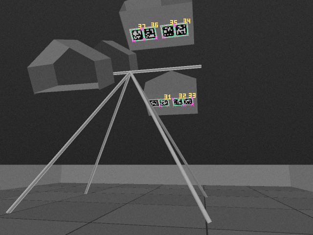
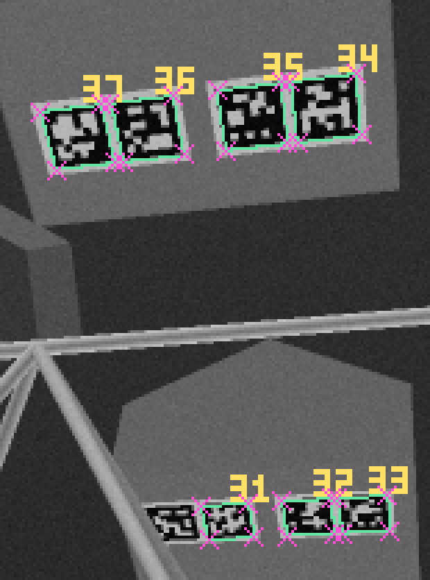
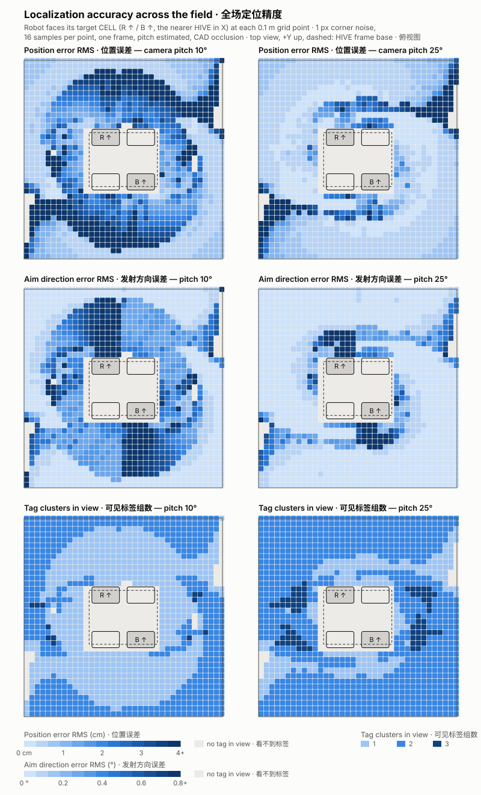
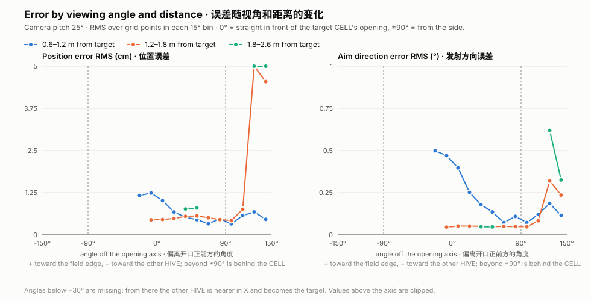

# 示例：从一帧相机图像到位姿和瞄准

[English](README.md) | **中文**

```bash
node examples/solve-example.js
```

脚本在页面之外把整条流程跑一遍：

1. **场景：** 红方射手位于 (−0.6, 1.8) m，朝向 −78.7°，面对自己朝上的 CELL。640×480、70° 相机离地 0.30 m。标定俯仰是 10°，但车体前仰了 2°，所以实际相机俯仰是 12°。传感器噪声 σ = 3 灰度。
2. **渲染** 相机看到的画面：地垫、围墙、官方 CELL 标签（手册 §9.9）、CELL 面板和 HIVE 支架。
3. **检测：** 用编译成 WebAssembly 的 AprilRobotics 检测器（`decimate` 1），只保留无纠错、解码余量不低于 10 的结果。
4. **求解** `(x, y, 朝向, 俯仰)`，俯仰以标定值 10° 为 ±3° 先验。对 4 种 HIVE 朝向布置分别求解，再融合 3 帧。
5. **检查：** 用质量门限检查结果，并换算成对射击的影响：转向开口中心的角度和发射方向误差。

[`output/`](output) 中的输出：

- [`camera.png`](output/camera.png)：检测器看到的画面。绿色是检测到的角点，黄色数字是标签 ID；品红色叉是用估计的位姿和俯仰重投影的标签角点。
- [`camera-zoom.png`](output/camera-zoom.png)：标签区域放大 4 倍。
- [`result.json`](output/result.json)：每个检测及其角点、带 1σ 的估计值、与真值的误差、瞄准和门限结果。
- [`console.txt`](output/console.txt)：打印的报告。





```
Robot (true)      x=-0.6 m  y=1.8 m  heading=-78.7°
Camera            640x480, HFOV 70°, height 0.3 m, pitch calibrated 10° / actual 12°
Detected tags     31(m=137.1) 32(m=133.3) 33(m=147.1) 34(m=164.8) 35(m=151.5) 36(m=157.6) 37(m=150.6)
Upward CELLs      red +Y, blue not seen (from the best-fitting layout)
Estimate          x=-0.5998 m  y=1.7998 m  heading=-78.708°  pitch=12.021°
1σ                x 0.18 cm, y 0.17 cm, heading 0.073°;  reprojection RMS 0.065 px, 3 frames
Error             position 0.03 cm, heading -0.008°
Aim               turn -0.08°, launch direction error 0.002° (0.01 cm sideways), range error -0.03 cm
Quality gate      passed (motion blur 0.0 px)
Fixed-pitch solve position error 12 cm, heading -0.44° (pitch held at the calibration)
```

怎么看这些结果：

- **看到了什么：** 解出 7 个标签，34–37 在目标 CELL 下方，31–33 在红色朝下的 CELL 下方。30 号没有解出，因为一根支架腿（1 in 管）挡在它的两个角前面：到这两个角的视线距腿轴线 0.1 cm 和 1.6 cm，而管半径是 1.27 cm。
- **HIVE 朝向：** 最吻合的布置是红色 +Y CELL 朝上，与真实一致。蓝色不在画面里，朝向记为未知。
- **俯仰：** 求解器只知道标定值 10°，却解出了 12.02°。同样的检测结果如果把俯仰固定为 10°，位置会偏 12 cm。
- **模拟条件：** 误差几乎为零，是因为光照理想、除俯仰外的标定准确、机器人静止。修改脚本顶部的场景，可以试其他位置、倾斜、噪声、分辨率或运动模糊（`effects.turnRateDegS`）。

## 全场定位精度

```bash
node examples/accuracy-grid.js              # 约 2 分钟
node examples/accuracy-grid.js --charts-only # 用 output/accuracy-grid.json 重画图表
```

设置：
- **网格：** 场地每 0.1 m 一个点（HIVE 底座以外共 1201 个）。每个点上机器人都朝向自己的目标，即 X 方向更近的 HIVE 朝上的 CELL。
- **相机：** 640×480、70°、离地 0.30 m，俯仰分别为 10° 和 25°。
- **噪声和遮挡：** 角点噪声 1 px，每点 16 次采样，单帧，俯仰按 ±3° 先验同时估计。遮挡按 HIVE 支架和官方 CAD 的 CELL 外壳计算。

在 SVG 中把鼠标悬停在格子或数据点上可看具体数值。原始数据见 [`output/accuracy-grid.json`](output/accuracy-grid.json)。





| 相机俯仰 | 能看到标签的点 | 位置误差 RMS：中位数 / 90% 分位 | 发射方向误差 RMS：中位数 / 90% 分位 |
|---|---|---|---|
| 10° | 1168 / 1201 | 1.42 / 4.8 cm | 0.28° / 0.72° |
| 25° | 1183 / 1201 | 0.46 / 2.7 cm | 0.05° / 0.42° |

**误差和角度有关吗？** 有关，但主要是间接的：角度和距离决定了 **画面里有几组标签**，而组数才是决定误差的因素：

| 可见标签组数（俯仰 25°） | 网格点数 | 位置误差中位数 | 方向误差中位数 |
|---|---|---|---|
| 1 | 208 | 2.8 cm | 0.46° |
| 2 | 903 | 0.42 cm | 0.05° |
| 3 | 72 | 0.26 cm | 0.05° |

能看到两组时，误差几乎不随角度变化：1.2–1.8 m、偏离开口正前方 −10° 到 +110° 范围内，都保持在 0.42–0.56 cm、0.05°。误差变大的地方有三处：

- **目标 CELL 正前方很近或正下方**（水平距离约 0.7 m 以内）：目标自己那组在画面上方之外，只剩对向组的 2–3 个标签。方向误差 1.3–2°。
- **目标 CELL 背后**（约 115° 以外）**且距离较远**：只能斜着看到一组远处的标签。1.2–1.8 m 时位置误差 4.5–5.6 cm；1.8 m 以外 13–20 cm，场地角落最差（只有 1 个标签时可达 31 cm）。方向误差 0.3–0.6°。
- **相机俯仰 10° 时：** 每个目标周围 0.8–1.6 m 有一圈误差较大的环带，目标那组标签从画面上方出去了。俯仰 25° 基本消除了这个环带。

**对射击的意义：** 在约 1.2–1.8 m、偏离开口轴线约 ±100° 以内射击，相机上仰约 25°。只看到一组标签时的估计要更谨慎：质量门限会放行，但误差大 5–10 倍。
